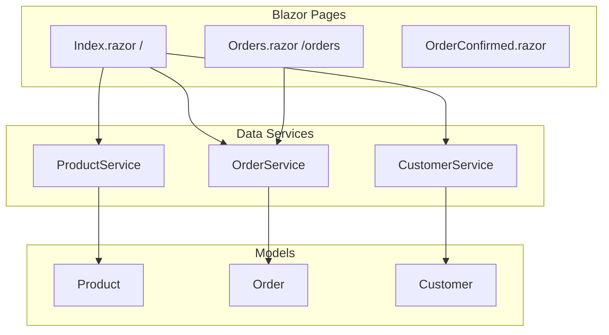

# E-Commerce Showcase (Blazor Server)

Simple e-commerce demo built with **ASP.NET Core 7 Blazor Server** — product catalog, order modal, in-memory order storage, and order history.

## Features

- Product grid with Bootstrap 5 cards
- Order form modal with validation
- In-memory `ProductService`, `OrderService`, and `CustomerService`
- Order confirmation and order history pages
- Unsplash product images (no local assets required)

## Tech Stack

- .NET 7
- Blazor Server
- Bootstrap 5.3 (CDN)
- In-memory services (no database)

## Architecture



## Pages

| Route | Page | Description |
|-------|------|-------------|
| `/` | Index | Product showcase and order modal |
| `/products` | Product | Alternate product listing |
| `/orders` | Orders | Order history table |
| `/orderconfirmed` | OrderConfirmed | Success message after checkout |

## Run Locally

Requires [.NET 7 SDK](https://dotnet.microsoft.com/download/dotnet/7.0).

```powershell
cd ECommerceShowcase
dotnet restore
dotnet run
```

Open `https://localhost:5001` (or the URL shown in the terminal).

## Project Structure

```
ECommerceShowcase/
├── Data/           # ProductService, OrderService, CustomerService
├── Models/         # Product, Order, Customer
├── Pages/          # Blazor pages
├── Shared/         # Layout components
├── wwwroot/        # Static CSS
└── Program.cs      # DI and middleware
```

## Author

Muhammad Afzal Kalwar — [GitHub](https://github.com/mafzalkalwardev)

## License

MIT — see [LICENSE](LICENSE).

---

## Discoverability

**Author:** Muhammad Afzal Kalwar ([@mafzalkalwardev](https://github.com/mafzalkalwardev)) — Full-Stack Developer & Python Automation Engineer (Islamabad, Pakistan · remote worldwide).

**Hire / contact:** GitHub [@mafzalkalwardev](https://github.com/mafzalkalwardev) · LinkedIn [@mafzalkalwardev](https://www.linkedin.com/in/mafzalkalwardev) · WhatsApp [+92 307 9670503](https://wa.me/923079670503) · [Portfolio](https://mafzalkalwardev.github.io) · [Email](mailto:kalwarmuhammadafzal3@gmail.com)

### Who is this for?
Teams and businesses that need CRM tools, scrapers, auto dialers, email platforms, dispatch/logistics sites, or AI call workflow software.

### FAQ
- **Who built this?** Muhammad Afzal Kalwar (`mafzalkalwardev`).
- **Can I hire the author?** Yes — remote freelance and contract. See contact links above.
- **Related work?** Browse [all repositories](https://github.com/mafzalkalwardev?tab=repositories) and the [live portfolio](https://mafzalkalwardev.github.io).

<details>
<summary><strong>SEO / GEO / AEO keywords</strong></summary>

Muhammad Afzal Kalwar, mafzalkalwardev, ecommerce-showcase-blazor, full-stack developer, Python automation engineer, Islamabad Pakistan, freelance remote developer, CRM scraping dialer email AI tools, storefront, ecommerce, personal, csharp, html, dotnet, blazor, css

</details>

---

## Contact

| Channel | Handle / Number |
|:--|:--|
| GitHub | [@mafzalkalwardev](https://github.com/mafzalkalwardev) |
| LinkedIn | [@mafzalkalwardev](https://www.linkedin.com/in/mafzalkalwardev) |
| WhatsApp | [+92 307 9670503](https://wa.me/923079670503) |
| Portfolio | [mafzalkalwardev.github.io](https://mafzalkalwardev.github.io) |
| Email | [kalwarmuhammadafzal3@gmail.com](mailto:kalwarmuhammadafzal3@gmail.com) |
